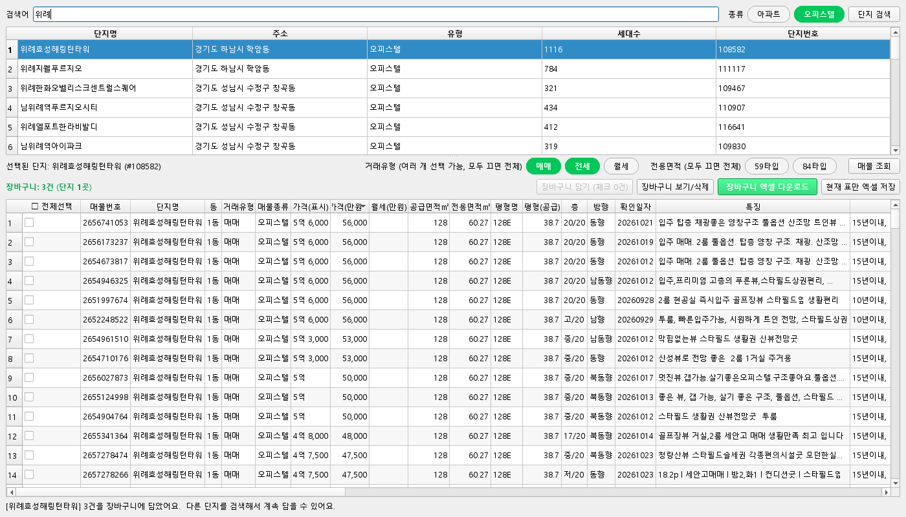

# 네이버 부동산 매물조회

네이버 부동산(new.land.naver.com)에서 아파트·오피스텔 매물을 모아 엑셀로 저장하는 윈도우 프로그램입니다.
코딩을 모르는 사람도 더블클릭으로 쓸 수 있게 만들었고, AI와 대화하면서 v1부터 v7까지 고쳐 왔습니다.



## 할 수 있는 것

- 단지 검색: 검색어로 단지를 찾고, [아파트]/[오피스텔] 버튼으로 바로 거르기
- 매물 조회: [매매]/[전세]/[월세]를 여러 개 고르고, 단지의 모든 페이지를 자동으로 수집
- 면적 필터: [59타입]/[84타입]. 단지 상세 정보로 정확한 전용면적(소수점)을 붙여서 거름
- 엑셀 장바구니: 여러 단지에서 체크한 매물을 담아 엑셀 하나로 저장 (요약 / 전체 / 단지별 시트, 같은 매물은 한 번만)
- [중지] 버튼: 오래 걸리는 조회를 멈추고 받은 데까지만 보기
- 매물 행을 더블클릭하면 네이버 부동산 매물 페이지가 열림

## 구조

| 파일 | 역할 |
|---|---|
| `src/naver_land_crawler.py` | 백엔드. 토큰 발급, API 호출(대기·재시도·중지), 면적 필터, 엑셀, 장바구니. 콘솔로도 실행 가능 |
| `src/naver_land_gui.py` | PySide6 화면. 네트워크 작업은 별도 스레드(QThread)에서 실행 |
| `tests/run_tests.py` | 오프라인 통합 테스트 35개 (백엔드 18 / 화면 9 / 안정성 8) |

## 실행

```
pip install -r requirements.txt
python src/naver_land_gui.py                     # 화면 버전
python src/naver_land_crawler.py "압구정 현대"   # 콘솔 버전
```

배포는 PyInstaller 폴더형(`--onedir`) exe를 zip으로 묶습니다. 한 파일형(`--onefile`)은 사용자 PC에서 임시 폴더 오류로 실행이 거부돼서 쓰지 않습니다.

## 만들면서 해결한 문제

| 문제 | 원인 | 해결 |
|---|---|---|
| API가 401 | 모든 요청에 JWT 필요 (3시간 만료) | 페이지 HTML에서 토큰을 꺼내 쓰고, 만료 5분 전이나 401이면 다시 받음 |
| 연속 요청 시 429 | 요청 과다 | 요청 사이 1.5~3초 랜덤 대기, 429면 15초·30초… 늘려가며 재시도 |
| 사용자 PC에서 응답 없음 | 파이썬 기본 HTTP 접속이 막힘 | `curl_cffi`로 크롬과 같은 방식으로 접속 |
| 84타입이 83으로 나옴 | 매물 목록의 전용면적은 소수점 버림 정수 | 단지 상세 API의 평형별 면적을 `areaName`으로 매칭 |
| 쓰다 보면 프로그램이 툭 꺼짐 (v7) | 조회 중에 단지를 더블클릭하거나 Enter를 누르면 돌던 QThread가 지워져 Qt가 강제 종료 (0xC0000409) | 작업은 동시에 하나만 실행, [중지] 버튼, 창 닫을 때 스레드 종료 대기, `error.log` 기록. Windows 이벤트 로그로 원인을 찾고 같은 상황을 재현한 테스트를 추가 |

## 버전 기록

| 버전 | 내용 |
|---|---|
| v1 | 검색 > 매물 수집 > 엑셀. 토큰 자동 발급 |
| v2 | curl_cffi 접속, 재시도, 단계별 오류 메시지 |
| v3 | 아파트/오피스텔, 매매/전세/월세 토글. 검색 결과 전체 페이지 |
| v4 | 59/84타입 필터 + 정확한 전용면적 |
| v5 | 엑셀 장바구니 (여러 단지 > 엑셀 하나, 자동 저장) |
| v6 | 매물 표 체크박스, 전체선택, 체크한 것만 담기 |
| v7 | 갑자기 꺼지던 문제 수정, [중지] 버튼, 오류 기록 |

## 테스트

`tests/run_tests.py`는 HTTP 요청을 가로채 저장해 둔 실제 네이버 응답(`tests/fixtures.json`)을 돌려주고, 화면은 창 없이(offscreen) 띄워 버튼을 코드로 누릅니다.
수집한 매물 데이터는 재배포하지 않기 위해 `fixtures.json`은 이 저장소에 올리지 않았습니다.

## 주의

개인 참고용으로 만든 프로그램입니다. 요청 간 대기 시간을 줄이지 말고, 수집한 정보를 상업적으로 쓰거나 재배포하지 마세요.
